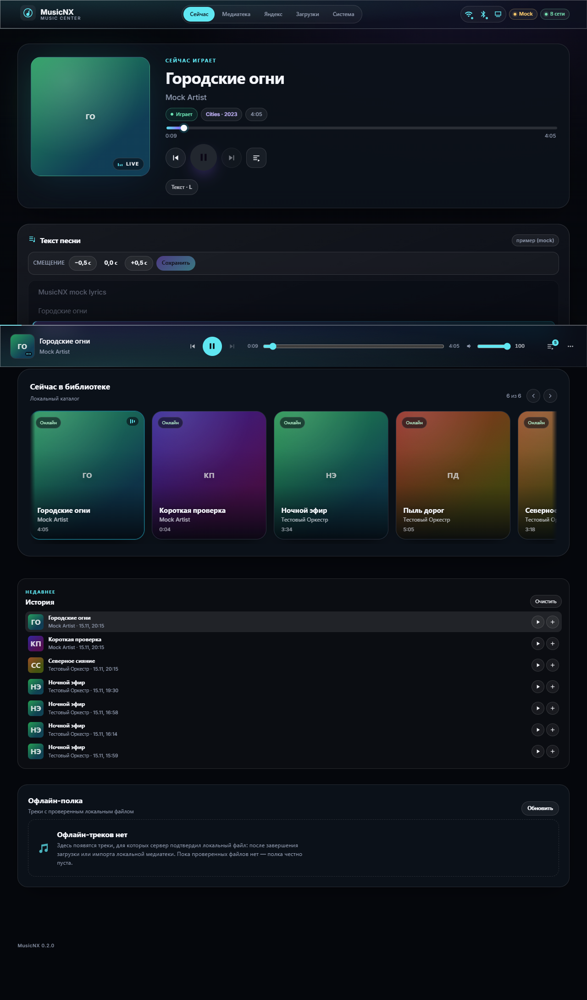
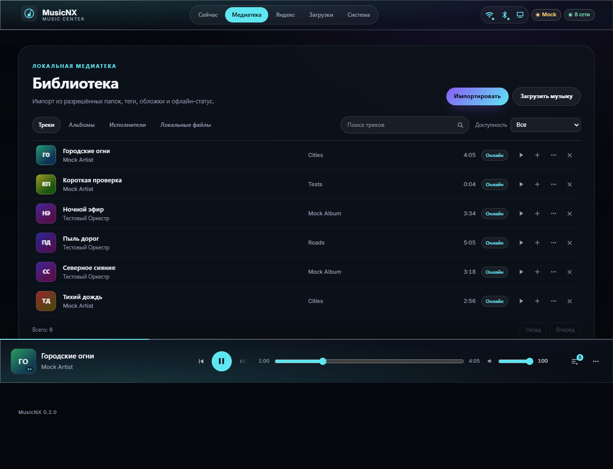

# MusicNX

[](#статус)
[](LICENSE)

Автономный музыкальный центр для **Raspberry Pi 3 без экрана**: локальная
медиатека и плеер работают всегда — интернет и «Яндекс Музыка» подключаются
по желанию. Управление — из браузера телефона, ПК или ТВ; на малине не нужен
ни монитор, ни Node.js, ни Docker. Один процесс на Python, SQLite, mpv.



> **Это бета.** Работает на реальном Pi 3 (реальный mpv-звук, импорт,
> стриминг, загрузки, зоны), но есть острые края — см. [Статус](#статус).

## Что умеет

- **Плеер и очередь:** play/pause/seek/next/previous, громкость; очередь
  сохраняется в SQLite и восстанавливается после перезагрузки (в паузе);
  shuffle и repeat (off / один трек / весь плейлист); очередь с разделом
  «Далее», переупорядочиванием и очисткой будущих треков.
- **Локальная медиатека:** импорт MP3/FLAC/AAC/M4A/WAV из своих папок или
  загрузка из браузера; теги (mutagen), обложки, дедупликация, FTS5-поиск по
  мере ввода, альбомы/исполнители с детальными страницами, мягкое удаление.
- **Яндекс Музыка (опционально):** вход по QR (Device Flow) или ручной токен;
  лайки, плейлисты (создание/переименование/удаление/треки), «Моя волна»,
  поиск с живым вводом, стриминг, тексты с караоке, загрузки для офлайна
  без транскодирования. Нужна своя подписка — см. [правовую рамку](#правовая-рамка).
- **Зоны вывода:** jack / USB-DAC / Bluetooth / браузер; громкость каждой зоны.
- **Телефон как пульт:** нижняя навигация в зоне большого пальца, крупные
  тач-таргеты; на «Система → Состояние» — **QR-код**: отсканируйте камерой, и
  интерфейс откроется на телефоне.
- **Мультивкладочность:** WebSocket — состояние, позиция и очередь
  синхронны между всеми открытыми вкладками/устройствами.
- **PWA:** ставится на домашний экран телефона; офлайн-оболочка честно
  сообщает «нет сети».
- **Система:** метрики CPU/RAM/температура/диск с графиками, Wi-Fi и BT-статусы,
  бэкапы БД, обслуживание, перезагрузка/выключение из UI.

## Установка на Raspberry Pi (бета)

Нужны: Raspberry Pi 3 (или новее) с Raspberry Pi OS Lite, карта ≥16 ГБ,
**БП 5 В / ≥2.5 А** (просадки питания — причина «залипаний»; не экономьте),
Ethernet или Wi-Fi. Управляйте с любого устройства в домашней сети.

```bash
# 1) Системные пакеты (один раз)
sudo apt update
sudo apt install -y mpv pipewire pipewire-pulse wireplumber python3-venv \
  avahi-daemon network-manager sqlite3 curl

# 2) Забрать проект
git clone https://github.com/Shiona1/musicnx.git
cd musicnx

# 3) Установка (venv + конфиг + systemd user service + health-check)
./scripts/install.sh
```

Установщик создаст `~/musicnx-data` (музыка, база, загрузки), сгенерирует
`config/config.yaml`, включит `musicnx.service` с linger и напечатает адрес:
`http://<адрес-малины>:8080` (или `http://<hostname>.local:8080`).
Сборка фронтенда уже включена (`backend/app/static`) — **Node.js на малине не нужен**.

Дальше:
- положите свою музыку в `~/musicnx-data/library` → «Медиатека → Импортировать»;
- «Яндекс» → «Подключить Яндекс» → QR/токен (нужна активная подписка);
- «Система → Состояние» → QR «Открыть на телефоне» — и малина в кармане.

Ручная установка, systemd-детали, сеть и диагностика:
[docs/DEPLOYMENT.md](docs/DEPLOYMENT.md).

### Попробовать без малины (mock)

На любой машине с Python 3.11+ и [uv](https://docs.astral.sh/uv/):

```bash
make install && make build && make mock   # http://127.0.0.1:8080
```

Mock-режим без Pi, mpv и токена: виртуальный аудиовыход, фиктивный каталог
Яндекса, вся логика и UI — настоящие. Безопасный способ посмотреть продукт.



## Статус

Реализовано и проверено на реальном Pi 3: mpv-воспроизведение, импорт,
стриминг и загрузки Яндекса, тексты/караоке, BT-зоны, systemd-запуск,
reboot-восстановление очереди. Открытые вопросы беты: длительный 24-часовой
прогон, AP-онбординг по Wi-Fi, физическое прослушивание USB-DAC, замена
слабого БП у тестового устройства (under-voltage). План —
[docs/ROADMAP.md](docs/ROADMAP.md); критерии —
[docs/ACCEPTANCE.md](docs/ACCEPTANCE.md).

## Безопасность

**Только домашняя LAN.** PIN удалён из модели доверия: любые действия
(импорт, настройки, перезагрузка) открыты всем в вашей сети. Не публикуйте
порт 8080 в интернет; для внешнего доступа ставьте reverse-proxy с TLS
([docs/SECURITY.md](docs/SECURITY.md)). Токен Яндекса хранится только на
малине (файл 0600) и не попадает в браузер, логи и WS.

## Правовая рамка

MusicNX — **неофициальный** клиент Яндекс Музыки для личного использования
при активной подписке; проект не связан с ООО «Яндекс». Скачанные треки —
только для личного офлайн-прослушивания, не распространяйте их. Полностью —
[docs/LEGAL.md](docs/LEGAL.md).

## Разработка

```bash
make check   # ruff + svelte-check + pytest (без сети и железа)
make dev     # backend с reload
make dev-web # Vite на :5173
```

Тесты не требуют Pi, mpv, токена или сети: всё внешнее — за mock-адаптерами.
Правила кода — [AGENTS.md](AGENTS.md); архитектура —
[docs/ARCHITECTURE.md](docs/ARCHITECTURE.md); полная документация — `docs/`.

## Документация

[SPEC](SPEC.md) · [ARCHITECTURE](docs/ARCHITECTURE.md) ·
[API](docs/API.md) · [DATABASE](docs/DATABASE.md) ·
[AUDIO](docs/AUDIO.md) · [DEPLOYMENT](docs/DEPLOYMENT.md) ·
[SECURITY](docs/SECURITY.md) · [OPERATIONS](docs/OPERATIONS.md) ·
[LEGAL](docs/LEGAL.md) · [ROADMAP](docs/ROADMAP.md) ·
[TESTING](docs/TESTING.md) · [ACCEPTANCE](docs/ACCEPTANCE.md)

## Лицензия

Код распространяется по [MIT](LICENSE). Зависимости сохраняют свои лицензии
(mpv — GPL; Python/Svelte-пакеты — см. их метаданные). Лицензия покрывает
код; контент Яндекс Музыки подчиняется условиям подписки и
[docs/LEGAL.md](docs/LEGAL.md).
